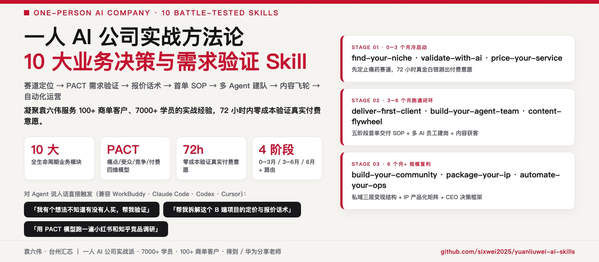
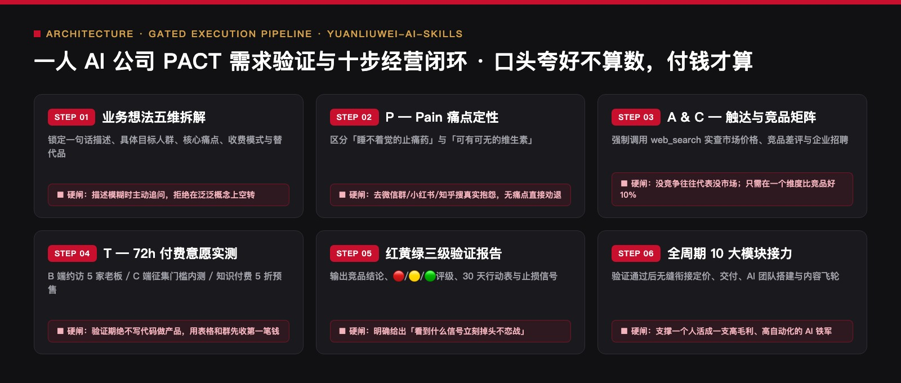

<div align="center">



# 一人 AI 公司实战方法论 Skills
### `yuanliuwei-ai-skills` · 从定位、PACT 72h 需求验证、定价收款到 Agent 团队搭建的 10 大业务决策模块

[](https://agentskills.io)
[](#三核心模块拆解validate-with-aipact-72-小时验证法)
[](#一为什么大多数人学了-ai-还是赚不到钱)
[](LICENSE)

> 🔴 **作者：袁六伟 · 台州汇芯**｜一人 AI 公司创业者，学员 7000+，服务商单客户 100+，覆盖近 20 个行业，得到 / 华为分享老师  
> 📮 更多 AI 工具实测与自动化实战，关注 **公众号 / 视频号：袁六伟**

**别把 AI 当玩具囤积——用做生意的底盘，把你的行业经验 + AI 杠杆变成能持续收钱的一人公司。**  
这是袁六伟在带出 **7000+ 学员、交付 100+ 企业商单（覆盖近 20 个行业）** 的实战中，把踩过的坑与跑通的闭环沉淀下来的 **一人 AI 公司 10 大方法论 Skill 体系**。首发内置核心死穴模块 **`validate-with-ai`（PACT 72 小时零成本需求验证器）**，帮你在写第一行代码、录第一堂课之前，先用最小动作验证客户愿不愿意掏钱。

```bash
# 方式 A：通过 skills CLI 一键安装（推荐）
npx skills add sixwei2025/yuanliuwei-ai-skills

# 方式 B：克隆到本地 Agent Skills 目录
git clone https://github.com/sixwei2025/yuanliuwei-ai-skills.git ~/.claude/skills/yuanliuwei-ai-skills
```

[为什么学了 AI 赚不到钱](#一为什么大多数人学了-ai-还是赚不到钱) · [10 大模块全景地图](#二一人-ai-公司-10-大模块全景地图) · [PACT 72h 需求验证详解](#三核心模块拆解validate-with-aipact-72-小时验证法) · [四阶段成长路线图](#四一人-ai-公司四阶段成长路线图) · [快速调用](#五30-秒快速调用示例)

</div>

---

## 一、为什么大多数人学了 AI 还是赚不到钱？

我们在 7000+ 学员和 100+ 企业客户咨询中发现，90% 的个人创业者死在以下三个误区：

1. **「拿着锤子找钉子」**：学会了搭工作流、调大模型，就关起门花两个月做一个自嗨的产品，上线后发现根本没人买单。
2. **「不敢谈钱、不会报价」**：要么免费帮人白干沦为廉价客服，要么一上来报天价把客户吓跑，缺乏阶梯式产品包设计。
3. **「把自己活成最累的外包工」**：所有交付全靠自己熬夜手搓，没有把重复动作沉淀成可复用的 **Agent 数字员工与 SOP**。

这套 Skill 的核心哲学只有一句话：**先用 AI 跑通最小收钱闭环，再把跑通的动作固化成自动化产线。**

---

## 二、一人 AI 公司 10 大模块全景地图

<p align="center">
  
</p>

| 阶段 | 模块代号 | 模块名称 | 解决的核心业务问题 |
| :---: | :--- | :--- | :--- |
| **01 · 冷启动** | `find-your-niche` | **赛道与长板定位** | 盘点你过往 3–5 年的行业经验，找到「离钱近、痛点硬、能用 AI 提效 5 倍」的细分切口 |
| **01 · 冷启动** | `validate-with-ai` ⭐ | **PACT 72h 需求验证** | **（本仓库核心内置）** 不写代码、不囤货，72 小时内用最小测试检验真伪需求 |
| **01 · 冷启动** | `price-your-service` | **阶梯报价与收款设计** | 设计「引流体验品 → 标准交付包 → 高客单顾问」三级价格锚点，告别低价内卷 |
| **02 · 首单交付** | `deliver-first-client` | **首单 MVP 交付 SOP** | 用 80 分确定性交付拿下前 3 个种子客户，同步沉淀真实前后端对比案例 |
| **02 · 首单交付** | `content-flywheel` | **实战案例内容飞轮** | 把每一次客户交付脱敏拆解成公众号深文 + 短视频脚本，让客户主动找上门 |
| **03 · 放大杠杆** | `build-your-agent-team` | **数字员工团队搭建** | 把选题、写稿、配图、视频、合同初审拆给专职 Skill，一个人活成一支队伍 |
| **03 · 放大杠杆** | `package-your-ip` | **IP 产品化与知识资产** | 把零散咨询打包成标准化训练营、企业内训课或付费 Skill 库 |
| **03 · 放大杠杆** | `build-your-community` | **高粘性社群与复购** | 设计高完课率、高口碑转介绍的交付陪伴机制 |
| **04 · 经营底盘** | `automate-your-ops` | **全链路运营自动化** | 线索跟进、案例归档、多平台分发与排期去重自动化 |
| **04 · 经营底盘** | `boss-level-thinking` | **一人公司老板心法** | 砍掉伪忙动作，算清单位时间 ROI，守住现金流与真实性底线 |

---

## 三、核心模块拆解：`validate-with-ai`（PACT 72 小时验证法）

本仓库根目录 [`SKILL.md`](SKILL.md) 完整内置了 **`validate-with-ai`** 执行协议。当你脑子里冒出一个「我想用 AI 做个 XX 赚钱」的想法时，Agent 会强制带你过 **PACT 四维审讯**：

| 维度 | 核心拷问 | 及格线（Pass） | 一票否决红灯（Fail） |
| :--- | :--- | :--- | :--- |
| **P · Pain（痛点强度）** | 这是客户的「止痛药」还是「维生素」？不解决会亏钱/挨骂吗？ | 能直接帮客户 **省下明确工时** 或 **带来可感知的询盘/营收** | 只是「看起来很酷、好玩」，没有明确买单理由 |
| **A · Audience（买单人群）** | 谁掏钱？你今天微信里能不能直接找到 5 个这样的人聊？ | 能精确说出人群画像，且拥有至少 1 个直接触达渠道 | 目标人群极其宽泛（如「所有想提升效率的年轻人」） |
| **C · Competition（替代方案）** | 客户现在是怎么凑合解决的？为什么要换你的方案？ | 现有方案要么太贵（外包几万块），要么太慢（人工手搓3天） | 大厂免费工具已经一键解决，毫无差异化空间 |
| **T · Transaction（最小交易）** | 72 小时内能不能不写代码，先拿一张海报/一份样稿收到第一笔定金？ | 能设计出 3 天内可执行的「收钱/收意向金」测试动作 | 必须先开发 3 个月系统才能给客户看第一眼 |

### 红 / 黄 / 绿三色立项裁决书

运行该 Skill 后，Agent 不会给你灌鸡汤，而是直接输出一份结构化的 **《PACT 需求验证裁决报告》**：
- 🟢 **绿灯（总分 ≥ 80）**：立即立项，输出未来 **72 小时最小收钱行动表（按天拆解到小时）**。
- 🟡 **黄灯（60–79 分）**：痛点真实但切口太宽或客单价过低，自动给出 **3 个切口收敛改写方案**。
- 🔴 **红灯（< 60 分）**：直接劝退，帮你省下接下来 2 个月白忙活的时间成本。

---

## 四、一人 AI 公司四阶段成长路线图

```text
阶段 1：0 → 1 破冰期（第 1–4 周）
  └─ 盘点长板 (find-your-niche) ──► 72h 需求验证 (validate-with-ai) ──► 收到前 3 笔真金白银

阶段 2：1 → 10 案例沉淀期（第 2–3 个月）
  └─ 跑通首单 SOP (deliver-first-client) ──► 每单拆解发公众号/视频号 (content-flywheel)

阶段 3：10 → 100 杠杆放大期（第 4–6 个月）
  └─ 搭建专属 Agent 产线 (build-your-agent-team) ──► 阶梯定价与知识产品化 (package-your-ip)

阶段 4：稳态复利期（6 个月+）
  └─ 全链路自动化 (automate-your-ops) ──► 老板视角算 ROI (boss-level-thinking)
```

---

## 五、30 秒快速调用示例

安装后，直接在 Claude Code / WorkBuddy 中输入你的真实业务想法：

```text
我想面向本地中小型服装厂老板，做一个「用 AI 自动生成模特穿搭图+抖音带货口播脚本」的代运营服务，客单价想收 3980 元/月。
请调用 validate-with-ai 帮我做一次严格的 PACT 72 小时需求验证，告诉我这个方向是红灯还是绿灯，以及接下来 3 天我具体该干什么。
```

---

## 关于作者与开源生态

**袁六伟 · 台州汇芯**：一人 AI 公司创业者，学员 7000+，服务商单客户 100+，覆盖近 20 个行业，得到 / 华为分享老师。AI 变现实战派，自己跑通才拿出来教。

- 公众号：**袁六伟**（微信搜一搜关注，看更多 AI 工具实测与一人公司实战）
- 视频号：**袁六伟**

这个项目免费开源。如果它帮你的产线省下了每天反复返工的时间，欢迎在右上角点个 ⭐ **Star**，也欢迎转发给身边做内容或一人公司的朋友。

### 同系列开源 Skill 矩阵（袁六伟 · 台州汇芯）

| 仓库 | 领域 | 核心能力 |
| :--- | :--- | :--- |
| [**workbuddy-wechat-autopilot**](https://github.com/sixwei2025/workbuddy-wechat-autopilot) | 公众号全链路 | 九步全自动总控：选题→写稿→真实截图→6套封面→6套排版→三重自动质检→草稿箱 |
| [**wechat-cover-skill**](https://github.com/sixwei2025/wechat-cover-skill) | 公众号视觉 | 封面渲染引擎（6套高客单价杂志风 + 黑红金 v2b + 防压脸自动校验） |
| [**gzh-million-layout-skill**](https://github.com/sixwei2025/gzh-million-layout-skill) | 公众号排版 | 汇芯红 `#C8102E` 六套 100% 内联 CSS 骨架 + 零乱码检查 + 配图皮肤 |
| [**ai-tool-review-wechat-skill**](https://github.com/sixwei2025/ai-tool-review-wechat-skill) | 公众号评测 | AI 工具真跑评测工作流（2.0 全自动压测 + 去碎句语感质检 + 六套骨架装配） |
| [**hit-title-expert-skill**](https://github.com/sixwei2025/hit-title-expert-skill) | 爆款标题 | 一次直出 10 条 14–22 字高浓缩狠标题（5大公式 × 5类钩子词） |
| [**auto-tutorial-skill**](https://github.com/sixwei2025/auto-tutorial-skill) | 短视频工程 | 链接/网页/真机截图 → 3:4 封面 + 1.5x 配音 + 红框标注教程视频 |
| [**talking-head-video-skill**](https://github.com/sixwei2025/talking-head-video-skill) | 短视频工程 | 1080×1920 竖屏真人口播短视频（ASR 错字校对 + 逐字卡拉OK字幕 + 6项QC） |
| [**3d-map-video-skill**](https://github.com/sixwei2025/3d-map-video-skill) | 短视频工程 | MapLibre 3D 地形 + WarFX 战争特效（粒子行军/点阵兵力/震屏混音） |
| [**psych-kepu-video-skill**](https://github.com/sixwei2025/psych-kepu-video-skill) | 短视频工程 | Remotion + JSON 驱动的 15–30s 深色扁平动画心理科普短视频 |
| [**dark-infographic-video-skill**](https://github.com/sixwei2025/dark-infographic-video-skill) | 短视频工程 | 纯 Python + FFmpeg 暗黑流光数据可视化科普片（含 v2 手机外放配乐） |
| [**local-video-hub**](https://github.com/sixwei2025/local-video-hub) | AI 团队基建 | 视频版本地 Obsidian：多 AI 员工统一交片、撞题查重与四态流转云台 |
| [**yuanliuwei-ai-skills**](https://github.com/sixwei2025/yuanliuwei-ai-skills) | 一人公司方法 | PACT 72h 需求验证模型与一人 AI 公司 10 大业务决策模块 |
| [**book-skill**](https://github.com/sixwei2025/book-skill) | 知识工程 | 上传任意书籍 PDF → 自动提炼方法论生成 `.skill` + 公众号导流文案 |
| [**huangdi-skill**](https://github.com/sixwei2025/huangdi-skill) | 认知操作系统 | 中国历史八大皇帝（秦始皇/汉武帝/唐太宗等）一手史料认知框架蒸馏 |
| [**sunrise-tracker**](https://github.com/sixwei2025/sunrise-tracker) | 选题雷达 | 小红书 AI 赛道 10 倍异常流量「低粉爆文」每日早 7 点监测推送 |
