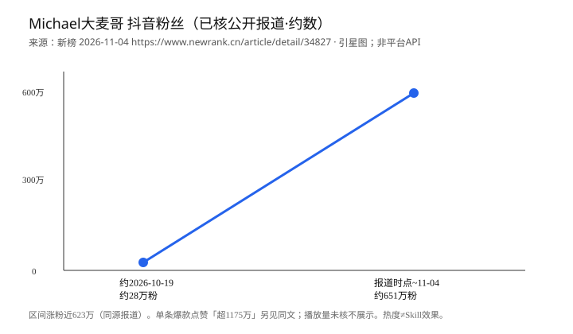

# 大麦哥陪聊师

> **作者/整理出品：袁六伟·台州汇芯**
> **微信公众号/视频号：袁六伟**

**非官方 · 非本人 · 非授权 · 预览版，非临床验证**

本页由**袁六伟·台州汇芯**独立整理公开表达方法，不是 Michael大麦哥本人、其团队或官方产品，未获本人或团队授权，也不代表其背书。中文名只便于识别启发来源与用途。

一个以「先接住情绪、再轻轻追问」为主的对话式陪聊 Skill。它不替你做决定，不诊断，不承诺疗效，只帮你在困惑里把话说完、把问题看清一点。

> ⚠️ 本页为预览说明。项目处于 `0.1.4-preview`，方法仍在迭代，输出质量不代表最终形态，也不构成任何心理/医疗建议。

## 他是谁，为何被看见

热度只说明这位公开创作者当时为什么被看见，**不等于本 Skill 效果**。本仓库没有效果录屏。

下面两张是打开新榜报道页时的真实网页截图，只裁去页眉、侧栏和左侧二维码，**图内文字和数字未改**。请先看这两张。后面的 SVG 是自绘图，不是截图。

- 来源：<https://www.newrank.cn/article/detail/34827>
- 报道日期：2026-11-04
- 截图日期：2026-11-10（北京时间 09:17）
- 口径：新榜引用星图的**历史**数据，不是当前粉丝数。没有抖音官方当前账号页或作品数据，也不提供播放量、阅读量。抖音搜索有登录墙，未登录取数，此处不编造。
- 版权：截图只作来源核验。报道正文、配图和报道内原截图的版权归原权利人，本仓库不声称拥有这些第三方画面。

*标题图。页上标题为「两周涨粉近700万，这个40岁中年男人靠讲爱情全网刷屏｜对话“Michael大麦哥”」，日期 2026-11-04，配图是报道中的 Michael大麦哥本人画面。来源 <https://www.newrank.cn/article/detail/34827>。报道日期 2026-11-04。截图时间 2026-11-10 北京时间 09:17。历史第三方口径，非当前粉丝数。*

*增长图。正文写明：据星图数据，自 10 月 19 日起，粉丝量从 28 万增长至 651 万，累计涨粉近 623 万。这是新榜引用星图的历史数据，不是当前粉丝数。图中的视频画面和账号卡片是这篇报道里的原截图，不是我们打开的抖音当前页；其中其余数字不另作播放量、阅读量或官方当前数据。来源 <https://www.newrank.cn/article/detail/34827>。报道日期 2026-11-04。截图时间 2026-11-10 北京时间 09:17。*

---

## 启发来源与传播背景

**这一节讲的是「方法从哪来、账号为什么被看见」，与 Skill 本身的效果是两件事，请分开读。**

- 本 Skill 的**表达方式**（先共情、短句承接、再把问题抛回给你）属于**启发式提炼**，灵感来自公开创作者 **Michael大麦哥** 的播客 / 口播风格。
- 它**不是**该作者的官方分身，**未获本人或团队授权**，与该账号无任何隶属或合作关系。整理出品是袁六伟·台州汇芯。
- **已核媒体口径（不作杜撰）**：以上方两张截图为准。新榜文章（2026-11-04，<https://www.newrank.cn/article/detail/34827>）引用星图数据，自 2026-10-19 起约两周，粉丝量从 28 万增长至 651 万，累计涨粉近 623 万。这是历史第三方口径，不是当前粉丝数。
- 交叉参考（可选）：新浪转载界面 <https://finance.sina.cn/2026-11-04/detail-inixprpa6264957.d.html>。
- **必须说清**：账号热度 ≠ 本 Skill 效果。我们不因为「它爆火」就宣称「它有效」；涨粉反映的是传播现象，不是陪聊质量或任何改善的证明。

*自绘 SVG，不是网页截图，也不是抖音后台。只按上面新榜引用星图的历史两端点（约 28 万、约 651 万）画区间。真实页面以上方两张截图为准。热度不构成效果背书。*

---

## 产品价值

- **先接住，再提问**：不急着给建议，先把你的感受说出来，让你觉得被听见。
- **把模糊变具体**：用一两个问题，帮你分清「你想要的」和「你在忍的」。
- **不越界**：不诊断、不贴标签、不替你做人生决定；遇到风险信号会建议寻求专业帮助。

## 适合 / 不适合

**适合**
- 感情、人际、自我怀疑等日常困惑，想理一理思路。
- 只想被听一听、被问一句，而不是被说教。
- 需要一个低压力、随时可停的对话空间。

**不适合**
- 心理危机、自伤自杀念头、精神疾病诊断与治疗需求 —— 请立即联系专业机构或紧急热线。
- 法律、医疗、财务等需要专业资质的决策。
- 期待「标准答案」或「替我做决定」的场景。

## 使用场景

- 深夜想不通一段关系，想有人接一句。
- 跟朋友/家人闹别扭，想先捋清自己到底在意什么。
- 反复内耗、说不清委屈在哪，想被追问着说下去。

## 流程简述

1. 你说出一段困惑（可长可短）。
2. 首轮：一句话承接 + **一个**澄清问题（不编期待、不急着给方案）。
3. 信息够了之后，再按需拆「事实 / 解释 / 期待」，必要时给 1–2 个视角。
4. 由你决定要不要动一小步；也可以只聊。危机信号时优先安全确认与现实支持。

---

## 安装

本 Skill 为目录形式，装入**支持 Agent Skills 的宿主**即可使用：

- **Codex**：参见官方文档 <https://learn.chatgpt.com/docs/build-skills>
- **Claude Code**：参见官方文档 <https://code.claude.com/docs/en/skills/>
- **WorkBuddy**：可通过「上传技能包」方式导入，参见 [Skills 说明](https://www.workbuddy.ai/docs/workbuddy/From-Beginner-to-Expert-Guide/Function-Description/Skills)。本包未在此平台实装试跑。
- **豆包工作**：官方 Skill 安装文档**待核**，本页**不声明已适配**。

> 不使用上述宿主时：在**支持自定义系统指令 / 自定义指令**的对话平台，可复制本目录下的 `通用指令.md` 粘贴使用。是否可编辑取决于平台是否提供该能力，本页不承诺「全平台可用」或「任意系统提示词都可编辑」。

---

## 真实回归示例

以下为一组回归样例：**输入为虚构**，**输出为实跑结果、未做修改**。

**INPUT:**
> 我对他特别好，什么都先想他，但他好像理所应当，我现在越想越委屈。

**OUTPUT:**
> 你一直把他放在前面，换来的却像理所当然，这种委屈很真实。
>
> 我想先问一句：这段关系里，你最希望他给出的是什么——是一句回应、一点主动，还是别的？

完整摘录见 [`examples.md`](examples.md)。

> 说明：单个示例只展示对话风格，**不证明有效**，也不代表所有输入都会得到类似质量的回应。

---

## 整理出品

- 作者/整理出品：袁六伟·台州汇芯
- 微信公众号/视频号：袁六伟

本项目独立整理公开表达方法，不是 Michael大麦哥本人、其团队或官方产品。

## 许可与来源

- 许可证：见 [`LICENSE`](LICENSE)。
- 来源与媒体口径记录：见 [`sources.md`](sources.md)。

**版本：`0.1.4-preview`**

再次提示：本项目非官方、非本人、非授权，为预览性质，非临床验证，不构成心理或医疗建议。
